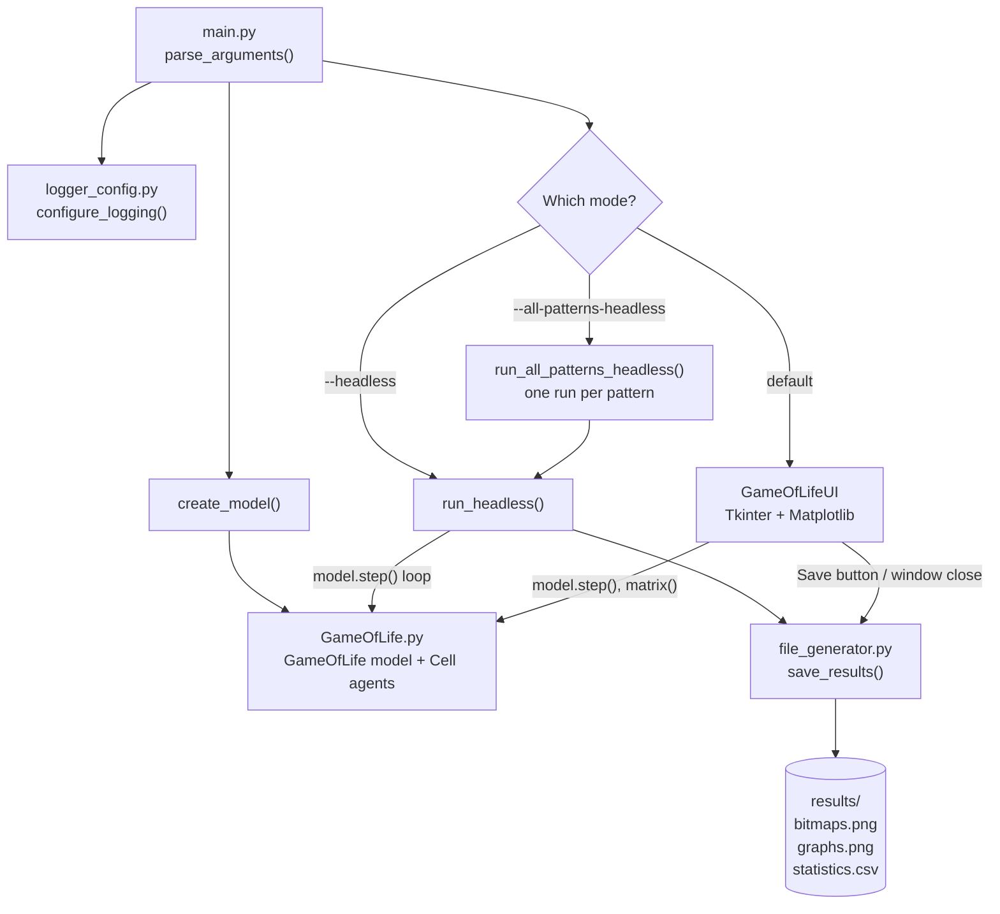
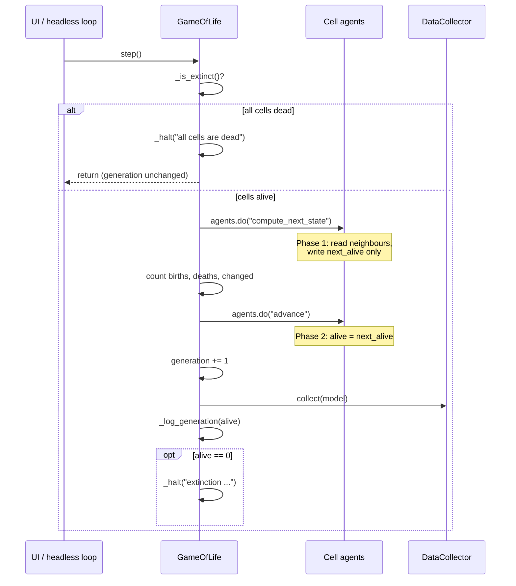
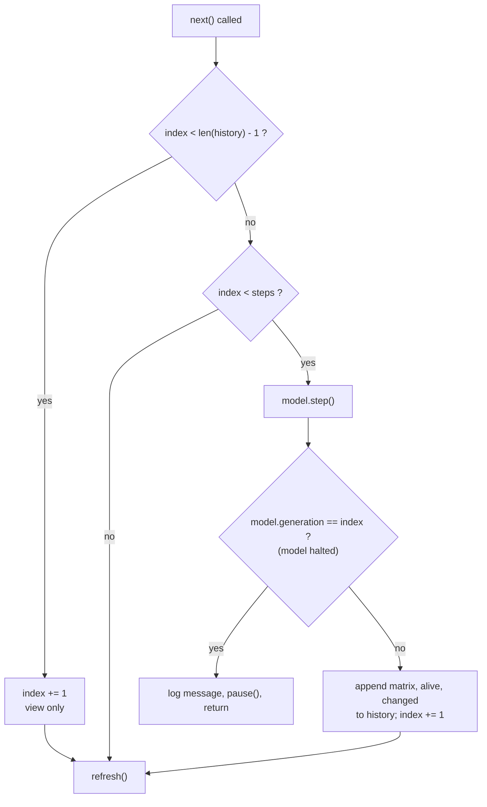

# Conway's Game of Life (Mesa) - How the Code Works

This project implements Conway's Game of Life as an **agent-based model** using the [Mesa](https://mesa.readthedocs.io) framework. Every grid position holds a `Cell` agent (alive or dead), and the model advances all cells together, one generation at a time. It can run **headless** (results saved to disk) or through an interactive **Tkinter + Matplotlib UI**.

> [!NOTE]
> As the model's docstring notes, Mesa adds overhead compared with a plain grid implementation. The goal is to demonstrate agent-based modelling, not speed.

---

## 1. Project structure

| File | Responsibility |
|---|---|
| `main.py` | Command-line entry point: parses arguments, builds the model, chooses headless or UI mode |
| `GameOfLife.py` | The Mesa model (`GameOfLife`), the `Cell` agent and the predefined `PATTERNS` |
| `GameOfLifeUI.py` | Tkinter window with Matplotlib plots, playback controls and click-to-draw |
| `file_generator.py` | `save_results()` - writes bitmaps, graph and CSV statistics |
| `logger_config.py` | `configure_logging()` - stderr and optional file logging |

## 2. Architecture overview

---

## 3. The model (`GameOfLife.py`)

### 3.1 Patterns

`PATTERNS` maps a name to a list of `(x, y)` live cells with the bounding box's top-left corner at `(0, 0)`: `single`, `block`, `blinker`, `glider`. `pattern_size(name)` returns the bounding-box width and height. When the model is built, the pattern is **centred** on the grid by computing an offset `((width - pw) // 2, (height - ph) // 2)`.

Besides these, two special values are accepted:

- `"random"` - each cell is alive with probability `density`
- `"custom"` - starts from the explicit `live_cells` list (empty if none given), used for drawing in the UI

### 3.2 The `Cell` agent

Every grid position always has exactly one `Cell`, even when dead. Each cell has two attributes:

- `alive` - the current state
- `next_alive` - the state computed for the next generation

The update is split in two phases so that all cells change **simultaneously**:

1. `compute_next_state()` - counts live Moore neighbours (8 surrounding cells) via `grid.get_neighbors(...)` and stores the result in `next_alive` using `apply_rules()`. Nothing visible changes.
2. `advance()` - copies `next_alive` into `alive`.

`apply_rules(alive, neighbors)` is a static method implementing the four classic rules:

| Current state | Live neighbours | Next state |
|---|---|---|
| Alive | < 2 | Dead (underpopulation) |
| Alive | 2 or 3 | Alive (survival) |
| Alive | > 3 | Dead (overpopulation) |
| Dead | exactly 3 | Alive (reproduction) |
| Dead | anything else | Dead |

### 3.3 The `GameOfLife` model

**Construction** (`__init__`):

1. `validate_parameters()` raises `ValueError` for grids smaller than 5×5, density outside 0–1, unknown patterns, patterns that do not fit, `live_cells` used without `"custom"`, or cells outside the grid.
2. `super().__init__(rng=seed)` seeds Mesa's random generator for reproducibility.
3. `self.config` stores `width, height, density, seed, torus`, so the UI can build an equivalent model later.
4. A `SingleGrid` is created (`torus=True` gives wrapping borders; otherwise borders are closed).
5. `_populate()` creates one `Cell` per position and places it on the grid.
6. `_setup_datacollector()` creates a Mesa `DataCollector` that tracks `generation`, `alive`, `changed`, `births`, `deaths`, and records generation 0.
7. `_log_ready()` logs the initial state.

**Helper methods:**

- `live_positions()` - set of `(x, y)` of all live cells
- `matrix()` - board as a list of rows indexed `[y][x]` (the order Matplotlib expects)
- `_is_extinct()` - `True` when no cell is alive

**Stepping** (`step()`):

Key points:

- **Births** are cells with `alive=False` and `next_alive=True`; **deaths** are the opposite; `changed = births + deaths`.
- A halted model leaves `generation` unchanged. Callers detect this by comparing `generation` before and after `step()`.
- If the user later draws cells on an extinct board, the next `step()` sets `running = True` again and the simulation resumes.

---

## 4. Entry point (`main.py`)

**Arguments:** `--height`, `--width` (default 50×50), `--seed`, `--density` (default 0.3), `--results` (default `results/`), `--headless`, `--initial-pattern` (`random`, `custom` or any pattern name), `--all-patterns-headless`, `--steps` (default 1000), `--torus`, `--debug`, `--log-file`.

**Flow of `main()`:**

1. Parse arguments and configure logging.
2. Reject negative `--steps`.
3. `create_model()` picks a seed (random if not provided, and logs it) and builds the `GameOfLife`.
4. Dispatch:
   - `--all-patterns-headless` → `run_all_patterns_headless()` copies the arguments for each pattern in `PATTERNS`, writes into `results/<pattern>/`, and calls `run_headless()`.
   - `--headless` → `run_headless()`.
   - otherwise → `run_tkinter_ui()`, which imports `GameOfLifeUI` lazily so headless mode works without a display.

**`run_headless()`** stores `model.matrix()` as generation 0, then calls `model.step()` up to `--steps` times, snapshotting the board after each. It stops early with a warning if the model halts. The `alive` and `changed` series come directly from `model.datacollector.model_vars`, and everything is passed to `save_results()`.

---

## 5. The UI (`GameOfLifeUI.py`)

### 5.1 Core idea: a forward-only model with a recorded history

Mesa models only move forward. To allow "Previous", the UI:

- keeps the model always at the **latest computed generation**,
- records a snapshot `model.matrix()` for each generation in `self.history` (plus `self.alive` and `self.changed` lists),
- uses `self.index` to point to the generation being **displayed**.

| Action | What happens |
|---|---|
| **Previous** | Pauses, then decrements `index` (display only) |
| **Next** inside history | Increments `index` (display only) |
| **Next** at the end of history | Calls `model.step()`, appends the new snapshot and statistics |
| **Play / Pause** | `tick()` calls `next()` repeatedly using Tk's `after()`, with delay `1000 / speed` ms |
| **Click on the current-generation plot** | Toggles the clicked `Cell`, only when viewing the latest generation |
| **Reset** | Builds a new model from `initial_live` (the stored generation 0, including drawn cells) |
| **Apply Pattern** | Builds a new model from the chosen pattern |
| **Save** | Calls `save_results()` |
| **Closing the window** | Pauses, saves, destroys the window |

Because Reset and Apply Pattern create a **new** `GameOfLife` from `model.config` (plus a pattern and optional `live_cells`), no state-copying code is needed.

### 5.2 Display

The window shows a 2×2 Matplotlib figure embedded with `FigureCanvasTkAgg`:

1. Previous generation (bitmap)
2. Current generation (bitmap, clickable)
3. Alive cells per generation (line chart)
4. Changed cells per generation (line chart)

`refresh()` updates the two images from `history`, redraws the curves, rescales axes and updates the "Generation: N" label.

### 5.3 Behaviour of `next()`

### 5.4 Editing cells

`on_click()` converts the clicked coordinates with `round()` (Matplotlib's `imshow` centres pixel *i* at coordinate *i*), checks they lie inside the grid, pauses, and ignores the click if the display is not on the latest generation. Otherwise it flips `cell.alive` (and `next_alive`), rewrites the last history snapshot and alive count, and, if this is generation 0, updates `initial_live` so Reset keeps the drawing.

---

## 6. Saving results (`file_generator.py`)

`save_results(history, alive, changed, folder)` creates the folder if needed and writes:

- `bitmaps.png` - first and final generation side by side
- `graphs.png` - alive and changed cells per generation on one chart
- `statistics.csv` - columns `generation, alive, changed`

## 7. Logging (`logger_config.py`)

`configure_logging(debug, log_file)` configures the `game_of_life` logger (child loggers such as `game_of_life.model`, `.ui`, `.files` and `.main` inherit it). It uses INFO level, or DEBUG with `--debug`, always logs to stderr, optionally also to a file, removes old handlers so it can be reconfigured safely, and quiets the `mesa` and `tkinter` loggers.

